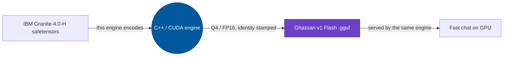

<div align="center">

# Ghassan v1 Flash — Inference & Training Engine

### *A from-scratch C++20 runtime for IBM Granite-4.0-H — rebranded as a standalone model artifact.*

[](CMakeLists.txt)
[](https://developer.nvidia.com/cuda-toolkit)
[](LICENSE)
[](https://huggingface.co/ghassan-ai/Ghassan-v1-Flash-GGUF)

**[Ghassan v1 Flash on Hugging Face →](https://huggingface.co/ghassan-ai/Ghassan-v1-Flash-GGUF)**

</div>

---

## What this is

| Layer | What it really is |
|---|---|
| **The engine** (this repo) | A self-contained C++20 runtime: its own tensor storage, CUDA kernels, tokenizer, GGUF codecs, MoE/Mamba-2 support, trainer. **No PyTorch, no Python at inference time.** |
| **The model** (the `.gguf`) | IBM Granite-4.0-H weights (6.94 B params, MoE + Mamba-2 hybrid) re-published under the identity **Ghassan v1 Flash** by team **Ghassan AI**. |



---

## Why it matters

- **Zero framework tax** — the engine owns memory end-to-end; a 6.94 B model fits a **T4 (16 GB) in FP16** and — with the built-in **native Q4** path — an **8 GB RTX 5060 at ~5 GiB** (verified on Kaggle).
- **Native Q4 dequant inside the kernels** — weights stay packed Q4_0/Q4_1/Q8_0 on the GPU; FP16 scratch used only where required, with a fused dequant-GEMM hot path.
- **Granite-4.0 hybrid** — 36 Mamba-2 layers + 4 GQA attention layers, top-6 MoE with shared expert, NoPE.
- **Roughly-one config** — the model, tokenizer, chat template and EOS are all embedded in the `.gguf`. Load with `--model file.gguf` and chat.

---

## GPU support (verified)

| GPU | Status | Notes |
|---|---|---|
| Tesla T4 (16 GB) | ✅ verified | FP16, Smol **5.03 GiB** Q4 mode (35% VRAM) |
| RTX 5060 (8 GB) | ✅ fits | `--weight-q4 0` native Q4, ~5 GiB |
| RTX 5060 Ti / 3090 / 4090 | ✅ | any mode |
| CPU-only | ✅ | slower reference path |

---

## Build

```bash
cmake -S . -B build -DGAI_ENABLE_CUDA=ON -DCMAKE_BUILD_TYPE=Release
cmake --build build --parallel
```

Artifacts: `./build/bin/ghassan-ai` (inference & export), `./build/bin/gai_train` (LoRA/QLoRA training).

```bash
# chat
./build/bin/ghassan-ai generate --model ghassan-v1-flash-FP16.gguf \
  --prompt "Explain mixture of experts in clear English." \
  --max-tokens 200 --device cuda --weight-f16 1

# native Q4 — fits 8 GB cards
./build/bin/ghassan-ai generate --model ghassan-v1-flash-Q4_0.gguf \
  --prompt "Explain mixture of experts in clear English." \
  --max-tokens 200 --device cuda --weight-q4 0 --gemm-fp16 1

# export from safetensors
./build/bin/ghassan-ai quantize --model <hf-dir> --out out.gguf \
  --profile fp16 --model-name "Ghassan v1 Flash" --version "1.0" --team "Ghassan AI" --compat native
```

## QLoRA / LoRA fine-tuning

```bash
./build/bin/gai_train --config <recipe.yaml> --model <ckpt-or.gguf> --weight-q4 0 \
  --device cuda --export trained.gguf --export-profile fp16
```

The base weights stay frozen and packed; only the FP32 LoRA adapters train.
`merge_lora()` folds them back into the base weights for export.

---

## Repository layout

```
core/          tensors, storage, dtype, ops (CPU + dispatch), quantized weights
cuda/          CUDA kernels: GEMM, MoE, Mamba-2, attention, mamba scan
model/         the model: forward/backward, memory plan, LoRA, Granite hybrid
inference/     generator, KV cache, sampler, chat session
tokenizer/     byte-level BPE + Granite/ChatML templates
format/        GGUF codec (read/write), HF checkpoint I/O
quantization/  Q8_0 / Q4_0 / Q4_1 block codecs (GGML-compatible)
training/      trainer: AdamW/Lion/Muon, grad accumulation, NCCL DDP
evaluation/    perplexity scoring
tools/         the ghassan-ai / gai_train CLIs
```

---

## Engineering rules

1. **No silent corruption** — every dtype boundary is explicit; half weights use dedicated `_half` kernels, never `Tensor::f32()` reinterpretation.
2. **No hidden OOM** — a plan-guard runs *before* any CUDA allocation and refuses impossible configs with a readable message.
3. **No fake identity** — exported artifacts carry `Ghassan v1 Flash / 1.0 / Ghassan AI`, **no** `base_model` field.
4. **Zero Python** — the engine is C++20 + CUDA; verification is local/CPU builds + Kaggle T4 smoke runs.

---

## Status

- Native Q4 (Q4_0 / Q4_1 / Q8_0): **verified** — 5.03 GiB, coherent English, end-to-end on Kaggle T4.
- LoRA / QLoRA (FP16 & Q4-packed): implemented & unit-tested.
- Inference decode: Mamba-2 single-token step fully on-device; fp16 KV cache; ring cache + pinned sink.

MIT-licensed. Built by **Ghassan AI**.
