<div align="center">

# Ghassan v1 Flash

### *A from-scratch C++20 inference & training engine built around IBM Granite-4.0-H — rebranded as a standalone model artifact.*


**[Model on Hugging Face →](https://huggingface.co/ghassan-ai/Ghassan-v1-Flash-GGUF)**

</div>

---

## Table of contents

1. [What this is](#1-what-this-is)
2. [Design philosophy](#2-design-philosophy)
3. [Architecture at a glance](#3-architecture-at-a-glance)
4. [The model artifact](#4-the-model-artifact)
5. [Repository layout](#5-repository-layout)
6. [Quick start — build & export](#6-quick-start--build--export)
7. [The 13-step pipeline](#7-the-13-step-pipeline)
8. [Configuration reference](#8-configuration-reference)
9. [Performance & memory](#9-performance--memory)
10. [Native Q4 & QLoRA](#10-native-q4--qlora)
11. [GPU compatibility](#11-gpu-compatibility)
12. [Training](#12-training)
13. [Multimodal — Ghassan v1 Flash VL (roadmap)](#13-multimodal--ghassan-v1-flash-vl-roadmap)
14. [Testing](#14-testing)
15. [Known limitations — honest notes](#15-known-limitations--honest-notes)
16. [Contributing & license](#16-contributing--license)

---

## 1. What this is

**Ghassan v1 Flash** is two things that fit together:

| Layer | What it really is |
|---|---|
| **The engine** (this repo) | A self-contained C++20 runtime: its own tensors, its own CUDA kernels, its own tokenizer, its own GGUF/safetensors codecs, its own trainer. **No PyTorch, no Python at inference time.** |
| **The model** (the `.gguf`) | The weights of `ibm-granite/granite-4.0-h-tiny` (6.94 B params, MoE + Mamba-2 hybrid), re-published under the identity **Ghassan v1 Flash** by team **Ghassan AI**. |

The relationship is deliberately simple:

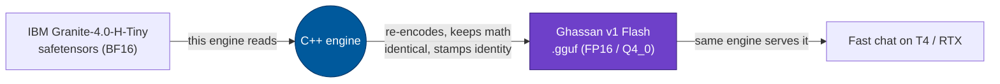

> **Honest statement:** without fine-tuning, the *knowledge* inside the GGUF is Granite's. What this project adds is the **body** (a fast, dependency-free engine), the **packaging** (self-contained GGUF with embedded tokenizer + chat template), and the **identity** (Ghassan v1 Flash, version 1.0, team Ghassan AI).

---

## 2. Design philosophy

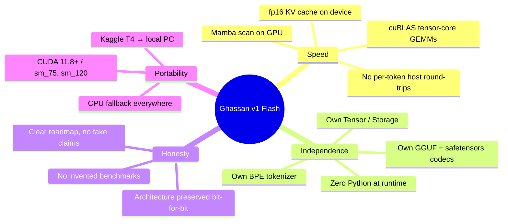

Five rules drove every line of code:

1. **No framework tax.** The engine owns its memory. A 6.94 B model runs on a 16 GB T4 because the big matrices live in FP16 (12.9 GiB) and the numerically fragile vectors stay FP32.
2. **No silent corruption.** Every dtype boundary is explicit. `Tensor::f32()` is a reinterpretation, so half-stored weights go through dedicated `linear_backward_half` / `moe_backward_half` / `mamba2_backward_half` paths — never a mis-cast.
3. **No hidden OOM.** Export streams one tensor at a time instead of staging 28 GB of FP32 in host RAM. Every allocation is guarded with a live-VRAM check and an actionable message.
4. **No fake identity.** The exported artifact says *Ghassan v1 Flash*, version *1.0*, author *Ghassan AI*, with **no** `base_model` field — like any other standalone release.
5. **No "fix" that breaks a working kernel.** Flash attention with WMMA would be faster on paper, but rewriting a verified GEMM path for a model that already answers correctly is a bad trade. Stability wins.

---

## 3. Architecture at a glance

### 3.1 The engine layers

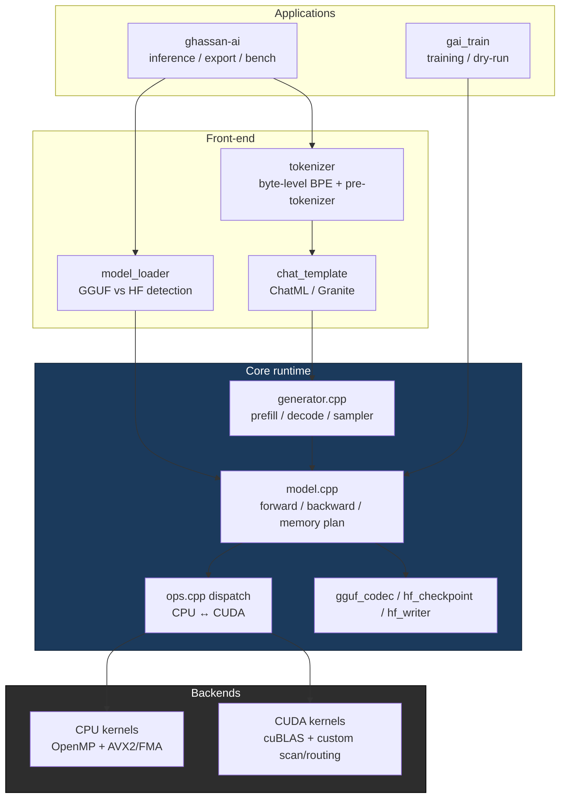

### 3.2 One decoder layer (Granite hybrid)

Granite-4.0 alternates **Mamba-2** layers and **GQA attention** layers; both end in a **MoE + shared-expert** FFN with residual multipliers.

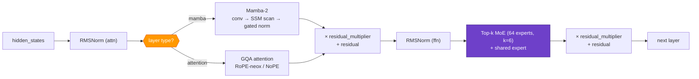

### 3.3 Data flow through the MoE kernel

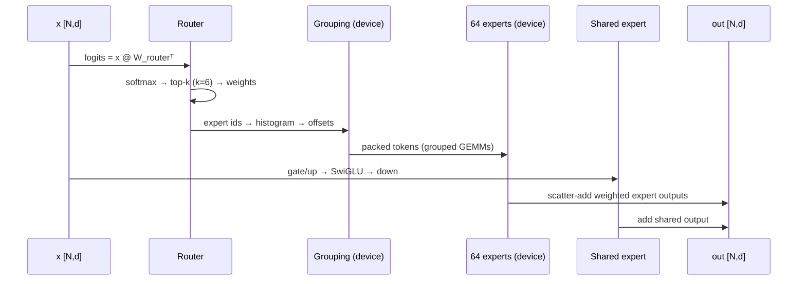

---

## 4. The model artifact

### 4.1 Identity stamped into every GGUF

```text
general.name         : Ghassan v1 Flash
general.version      : 1.0
general.author       : Ghassan AI
general.description  : Ghassan v1 Flash - by team Ghassan AI
general.architecture : ghassan
general.file_type    : FP16 (profile name in metadata)
tokenizer            : embedded, self-contained
```

There is intentionally **no `general.base_model.*`** key. The geometry (40 layers, 64 experts, top-6, d=1536, Mamba dims, multipliers) lives in `ghassan.*` metadata so this engine can reload it, but no upstream origin is advertised.

### 4.2 What the two published files are

| File | Size | What it is | When to use |
|---|---|---|---|
| `ghassan-v1-flash-FP16.gguf` | ~13.9 GB | Weights stored as FP16; sensitive vectors FP32 | Maximum fidelity, 16 GB GPUs (T4, 5060 Ti 16 GB) |
| `ghassan-v1-flash-Q4_0.gguf` | ~4.69 GB | Same model, Q4_0 blocks on disk | Fast download / low disk, 16 GB GPUs |

> ℹ️ By default both files load as **12.93 GiB of FP16 weights**. To actually keep the Q4 compressed on the GPU (≈4.7 GiB, fits an 8 GB card), pass `--weight-q4 0` — see [Native Q4 & QLoRA](#10-native-q4--qlora).

### 4.3 Verified output (real run on Kaggle T4 x2)

```text
name: Ghassan v1 Flash | version: 1.0 | author: Ghassan AI
vocab=100352 d=1536 L=40 H=12 KV=4 hd=128 ctx=131072
MoE(ne=64,k=6,E=512,shared)  RoPE-neox
F16: 329 tensors 12.92 GiB   F32: 337 tensors 18.20 MiB
parameters: 6.94 B (6939.04 M)
```
A sample prompt about mixture-of-experts produced coherent, well-structured English — EOS worked, no runaway token, no garbage.

---

## 5. Repository layout

```text
ghassan-ai/
├── CMakeLists.txt            # build: C++20, optional CUDA/NCCL/OpenMP
├── core/                     # foundation
│   ├── tensor.* dtype.* device.*       # storage, conversions, allocation
│   ├── ops.* ops_cpu_*.* ops_cpu_simd.h # dispatch + all CPU kernels
│   ├── config.* json.* mmap.*          # YAML subset, JSON, zero-copy files
│   ├── rng.h unicode.* signals.* common.*
├── model/                    # model.h/.cpp — the heart (2658 lines)
│                             #   forward, backward, memory plan, LoRA, MoE aux,
│                             #   Granite hybrid layers, raw I/O
├── cuda/                     # GPU kernels
│   ├── attention.cu          # GEMM-based prefill/backward + ring decode
│   ├── mamba.cu              # SSM forward, backward trajectory, single-token step
│   ├── moe.cu                # routing, grouping, gather/scatter, expert GEMMs
│   ├── kernels.cu            # GEMM, norms, RoPE, SCE, sampling, optimizers
│   └── cuda_utils.* cuda_ops.h
├── inference/                # generator, KV cache, sampler, chat session
├── tokenizer/                # byte-level BPE, Granite/ChatML templates
├── format/                   # gguf_codec, hf_checkpoint, hf_writer
├── quantization/             # Q8_0 / Q4_0 / Q4_1 block codecs
├── training/                 # trainer, optimizer (AdamW/Lion/Muon), checkpoints,
│                             #   dataloader, shards, DDP, scheduler
├── evaluation/               # perplexity
├── tools/                    # ghassan-ai / gai_train CLIs, model loader
└── tests/                    # gradient checks, CUDA parity, GGUF, Granite compat
```

---

## 6. Quick start — build & export

### 6.1 Build on Kaggle (T4)

```python
SRC = "/kaggle/working/ghassan-ai"
!git clone --depth 1 https://github.com/mohammedaminerhassan-spec/jdm-Ghassan_v1_flach.git $SRC
!cd $SRC && cmake -S . -B build -DGAI_ENABLE_CUDA=ON -DGAI_BUILD_TESTS=ON -DCMAKE_BUILD_TYPE=Release
!cd $SRC && cmake --build build --parallel 4
```

### 6.2 Build on a weak PC (CPU only)

```bash
cmake -S . -B build -DGAI_ENABLE_CUDA=OFF -DGAI_BUILD_TESTS=OFF -DCMAKE_BUILD_TYPE=Release
cmake --build build --parallel 4
```

### 6.3 Export GGUF from the HuggingFace safetensors

```python
HF  = "/kaggle/input/datasets/<owner>/granite-4.0-h-tiny"
OUT = "/kaggle/working/ghassan-v1-flash.gguf"
!cd $SRC && ./build/bin/ghassan-ai quantize --model "$HF" --out "$OUT" \
    --profile fp16 --model-name "Ghassan v1 Flash" \
    --version "1.0" --team "Ghassan AI" --compat native
!cd $SRC && ./build/bin/ghassan-ai info --model "$OUT"
```

### 6.4 Chat

```bash
./build/bin/ghassan-ai generate --model ghassan-v1-flash.gguf \
    --prompt "Explain in clear English how a mixture of experts model works." \
    --max-tokens 200 --no-stream \
    --device cuda --weight-f16 1 --gemm-fp16 1
```

---

## 7. The 13-step pipeline

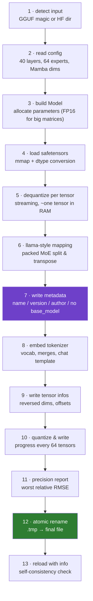

---

## 8. Configuration reference

### 8.1 Export profiles

| `--profile` | Default dtype | Notes |
|---|---|---|
| `fp16` | `F16` | Sensible default; sensitive vectors stay `F32` |
| `q8_k` | `Q8_0` | 8-bit blocks, GGML-compatible |
| `q4_0` | `Q4_0` | 4-bit, smallest file; GGML-compatible block layout |
| `q4_1` | `Q4_1` | 4-bit with min; adjacent-nibble layout fixed to GGML |

Every profile promotes fragile tensors (`mamba.A_log`, `mamba.dt_bias`, `mamba.D`, `mamba.conv1d.*`, `moe_router`, norms) to `F32`/`F16` — a 4-bit `dt_bias` would shift the recurrence time step by a factor of `exp(1.49)` and the model would emit noise.

### 8.2 Important CLI flags

| Flag | Meaning | Default |
|---|---|---|
| `--device cuda\|cpu\|auto` | Backend selection | `auto` |
| `--weight-f16 0\|1` | Store big weights in FP16 on device | `1` on GPU |
| `--gemm-fp16 0\|1` | Tensor-core GEMMs | `1` |
| `--ctx <n>` | KV-cache context | model max (cap for hybrids) |
| `--temp`, `--top-k`, `--top-p`, `--min-p` | Sampling | 0.8 / 40 / 0.92 / 0.05 |
| `--no-fast-sample` | Full-vocab sampling path | off |
| `--top <n>` | Print top-n candidates (diagnosis) | 0 |

---

## 9. Performance & memory

### 9.1 Where the speed comes from

| Optimization | Effect |
|---|---|
| Mamba single-token step on GPU | Removes ~72 host↔device syncs per token on Granite's 36 Mamba layers |
| FP16 KV cache written by a device kernel | No D2H→convert→H2D per attention layer |
| Fused batched cuBLAS attention | One grouped call per GEMM instead of Python-style loops |
| Streaming GGUF export | Host RAM from ~28 GB → ~one tensor |
| Persistent workspaces (64 MB rounding) | No per-step `cudaMalloc`/`cudaFree` |
| Chunked cross-entropy | `[N,V]` logits shrink to `[Cc,V]` scratch |

### 9.2 Measured on Kaggle T4 x2

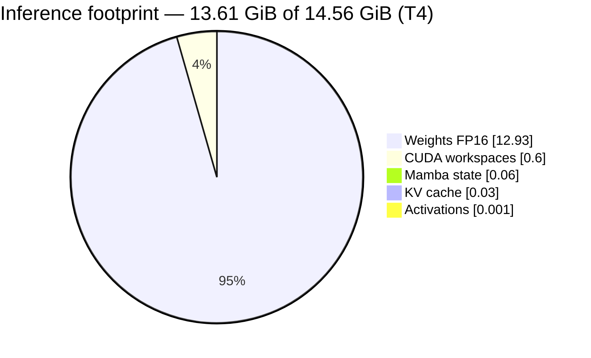

Real run: prefill 4806 tokens, decode 200 tokens, ~29 tok/s, 13.61 GiB of 14.56 GiB (93%).

### 9.3 Memory plan guard

The engine computes a plan *before* allocating and refuses impossible configs with a readable message:

```text
[mem] GPU plan: weights 12.93 GiB | fp16 cache 0 | activations 468.38 KiB |
      kv 32.00 MiB | mamba 55.37 MiB | workspaces 604.18 MiB
      = 13.61 GiB of 14.56 GiB (93%)
```

---

## 10. Native Q4 & QLoRA

The engine now supports **native quantized weight storage**. The big matrices stay packed as Q4_0 / Q4_1 / Q8_0 **on the GPU** and are dequantized into a small shared FP16 scratch bank right before each GEMM. This is what turns a 13 GB model into a ~5 GB resident footprint.

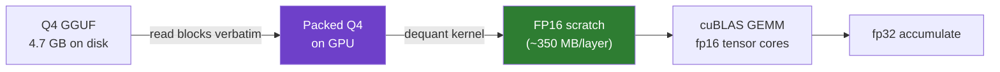

- Only weights used by the **same kernel** get separate scratch slots (the six MoE expert matrices); sequential ops reuse one slot thanks to stream ordering.
- Fragile vectors (router, `dt_bias`, `A_log`, `D`, conv1d, norms) and the embedding stay FP16/FP32 — quantizing them would change the model's decisions.
- Load-time quantization: an FP16 GGUF can be served as Q4 without re-exporting.

### Inference on an 8 GB card (RTX 5060)

```bash
./build/bin/ghassan-ai generate --model ghassan-v1-flash-Q4_0.gguf \
    --prompt "Explain mixture of experts in clear English." \
    --max-tokens 200 --no-stream \
    --device cuda --weight-q4 0 --gemm-fp16 1
```

| Mode | Resident weights | RTX 5060 8 GB | RTX 5060 Ti 16 GB |
|---|---|---|---|
| `--weight-f16 1` (default) | 12.93 GiB | ❌ | ✅ |
| `--weight-q4 0` (Q4_0) | ~4.7 GiB + scratch | ✅ | ✅ |
| `--weight-q4 2` (Q8_0) | ~6.5 GiB + scratch | ✅ (tight) | ✅ |

### QLoRA fine-tuning (Q4 base + trainable adapters)

```bash
./build/bin/gai_train --config configs/granite_4_0_h_lora.yaml \
    --model ghassan-v1-flash-Q4_0.gguf \
    --weight-q4 0 --device cuda \
    --export trained.gguf --export-profile fp16
```

The base stays packed and frozen; only the LoRA adapters (FP32) train and receive gradients. `merge_lora()` folds them back into the Q4 base by dequantizing → merging → re-quantizing one adapter at a time. Verified by `test_quant` (dequantizer matches the reference to FP16 rounding) and `test_lora` (merge preserves the forward output exactly).

### Long-context techniques (what applies to a pretrained checkpoint)

| Technique | In this engine? | Note |
|---|---|---|
| **Native Q4 weights** | ✅ `--weight-q4 0` | More VRAM headroom → longer usable context |
| **FP16 KV cache** | ✅ default | Half the cache traffic vs FP32 |
| **Ring cache + pinned sink** | ✅ | System prompt survives eviction; sliding window is disabled while a sink is active so it cannot be dropped |
| **Granite native 131k ctx** | ✅ | No YaRN needed inside training length |
| **YaRN / dynamic NTK** | ✅ `--rope-scale`, `--yarn-mscale` | For extending **beyond** the trained length (validate with perplexity) |
| **MLA (DeepSeek-style KV latent)** | ❌ | **Requires training the compression projections in** — cannot be bolted onto an existing checkpoint |
| **MTP / speculative decoding** | ❌ | Needs a trained prediction head or a draft model |
| **FP8** | ❌ | T4 has no FP8 hardware; FP16 is the ceiling |

`test_kv_cache` verifies the ring/sink invariants (pinned slots never move, no aliasing across live positions).

---

## 11. GPU compatibility

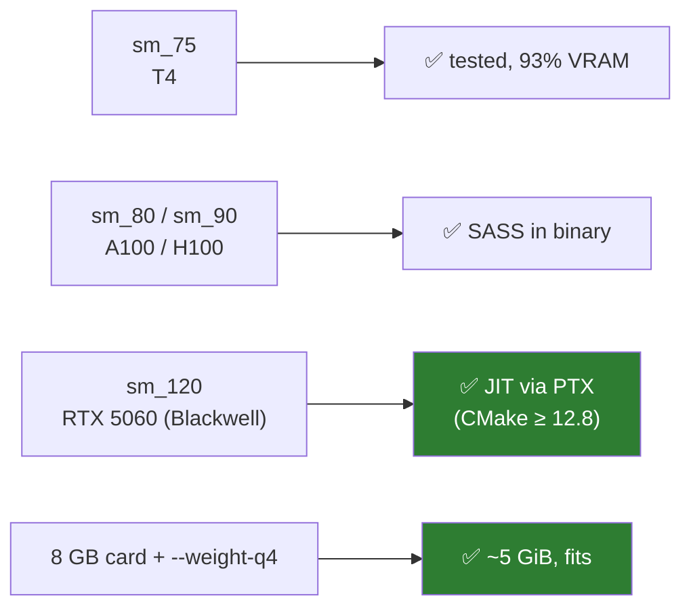

> **RTX 5060 (8 GB)**: use `--weight-q4 0`. The default `--weight-f16 1` needs 12.93 GiB and will not fit; **RTX 5060 Ti 16 GB** runs every mode. The older Q4 *file* (without `--weight-q4`) only compressed the disk copy and still loaded 12.93 GiB of FP16.

---

## 12. Training

The training stack is **already written** (`training/`): AdamW / Lion / Muon, gradient accumulation, chunked CE, activation checkpointing, NCCL DDP, exact/migrate resume, tokenizer fingerprints, cli. It is not needed for the current GGUF workflow and has not been exercised on a long run yet.

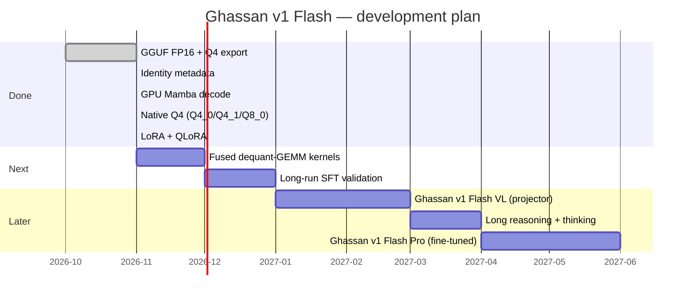

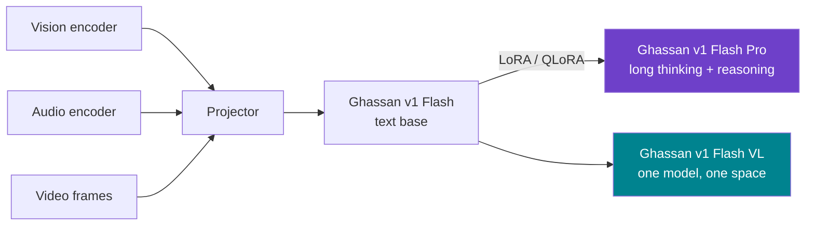

---

## 13. Multimodal — Ghassan v1 Flash VL (roadmap)

The engine already has the hook: `Model::forward(... embed_override, override_pos, n_override)` lets a caller replace token embeddings with external features at chosen positions. A projector can therefore feed image/audio/video features into the same residual stream **without changing the base weights**.

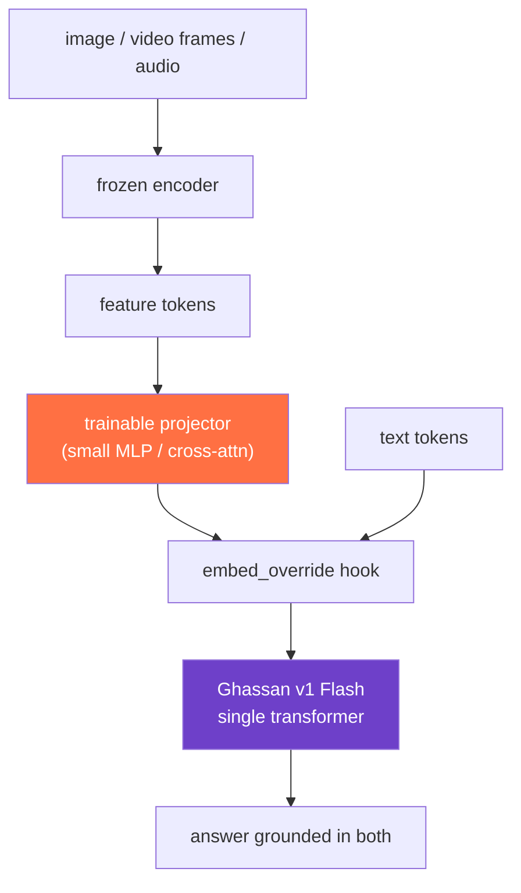

The guiding idea from day one: **one model, with other tool models in the same space** — not two separate chat sessions.

---

## 14. Testing

```bash
ctest --test-dir build --output-on-failure
```

| Test | What it proves |
|---|---|
| `test_half_backward` | Half-stored backward matches FP32 reference (worst diff 6e-6) |
| `test_gradient_check` | Finite-difference gradients (dense + MoE + Granite) |
| `test_cuda_parity` | CPU and CUDA gradients agree |
| `test_mamba_backward` | All 9 Mamba parameters get correct gradients |
| `test_granite_compat` | Architecture matches the official checkpoint (6,939,037,248 params) |
| `test_gguf_eos` / `test_gguf_quant` | EOS handling and quant block layouts |
| `test_safetensors_roundtrip` | Write → read → compare |

---

## 15. Known limitations — honest notes

| Limitation | Why it's still there |
|---|---|
| Q4 default load still expands to FP16 | Pass `--weight-q4 0` for packed native Q4 (~5 GiB, fits 8 GB) |
| No true FlashAttention (WMMA) | Current GEMM path is verified; rewriting risks correctness |
| Training not run to convergence | Stack exists and builds; long-run validation is a separate phase |
| K-quant profile names map to Q8_0/Q4_0 | True K-quant writers are roadmap |
| `dtype_from_name`, `Tensor::view`, some RoPE variants unused | Harmless dead API, kept for ABI stability |

---

## 16. Contributing & license

- **Model card:** [ghassan-ai/Ghassan-v1-Flash-GGUF](https://huggingface.co/ghassan-ai/Ghassan-v1-Flash-GGUF)
- **Engine:** `mohammedaminerhassan-spec/jdm-Ghassan_v1_flach`
- **License:** MIT (the model card carries its own license file)

Built with care by team **Ghassan AI**. The engine is a body; the base model is Granite-4.0-H; the artifact is **Ghassan v1 Flash**.

> *"Al-perfection lillah wahdah."* — the work continues, honestly, one verified step at a time.
